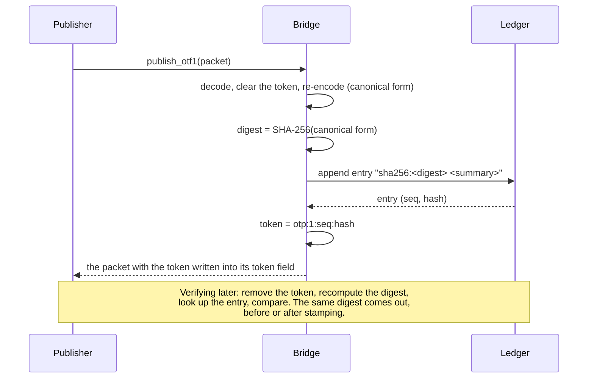

# The OTF-1 / OTB-1 bridge

*Publish a mission event or a spending record into the ledger, stamp it with a coordinate, and let anyone check that the stamp is about that record.*

- **Where:** [`bridge/`](../bridge/), an optional target, off by default
- **Needs:** libotf1 and libotb1, as git submodules under `bridge/deps/`
- **The core library still depends on nothing.** Building the bridge is the only thing that needs the other repositories.

## 1. What it does

[`LEDGER.md` §0](LEDGER.md) replaces the blockchain "proof token" in OTF-1 and OTB-1 with a coordinate into this ledger, `otp:1:8412:9f3c1a4e77b20d51`. The core library implements the coordinate ([`otp_token.h`](../include/otp/otp_token.h)). That is half of it.

The other half is what a coordinate cannot do alone. It proves an entry exists and has not been altered. **It does not prove the entry is about any particular packet**, so a valid token pasted into an unrelated packet would still check out. The bridge makes each entry commit to the packet it records, so the two can be compared.

```cpp
#include <otp/otp_bridge.h>

otp::Ledger ledger;
ledger.set_commitment_key(key);                 // held separately from the ledger
ledger.set_instance("overby-ops", "OTF-1+OTB-1/1.0");

otp::Bridge bridge(ledger);

// A mission event: recorded, and returned with its coordinate in the token field.
otp::Published event = bridge.publish_otf1(event_json);
if (!event.ok) { /* event.error says why */ }
send_to_the_public_feed(event.stamped);         // publish this, not event_json

// A spending record. The caller says whether the vendor is a legal entity.
otp::Otb1Options options;
options.vendor = otp::VendorKind::LegalEntity;
otp::Published record = bridge.publish_otb1(record_json, options);

// Anyone holding a copy of the ledger can check a stamped packet.
otp::Verification v = bridge.verify_otf1(stamped_json);
if (!v.verified()) { /* v.verdict and v.reason say what is wrong */ }
```

## 2. The circle, and how it is broken

The token lives inside the packet. The token is the hash of the entry. The entry commits to the packet. Taken literally that is circular: the entry would have to contain its own hash.

The way out: **the digest is taken over the packet with its token field removed.**



## 3. The canonical form

Two serialisations of one packet (different key order, whitespace, an offset instead of `Z`) must give one digest. Otherwise the same record could be published twice, and a check could fail for a reason that has nothing to do with tampering.

So the digest is taken over the **canonical form**: the packet is parsed and validated by the reference decoder, its token is cleared, and it is re-encoded by the reference encoder. That writes a fixed member order, UTC timestamps, and the shortest exact number form. Anything the decoder rejects is not publishable.

The form is specified in full in the docstring of [`bridge/tools/golden.py`](../bridge/tools/golden.py), which **reproduces it in independent code**, sharing nothing with the C++. The C++ tests read `bridge/tests/golden.txt`, generated by that script from the example packets, and require their own canonical form and digest to match every line byte for byte. CI checks the file has not drifted. A verifier in another language can be held to the same bytes.

## 4. What the ledger records

| Ledger field | OTF-1 event | OTB-1 record |
|---|---|---|
| `citation` | `OTF-1` | `OTB-1` |
| `kind` | `otf1.<action>`, for example `otf1.captured` | `otb1.<type>`, for example `otb1.land` |
| `subject` | the pod, **named**: a machine is not a person | the vendor: named or committed, see §5 |
| `standing` | `determined` | `determined` |
| `tick` | the packet's timestamp, in milliseconds since the Unix epoch | the same |
| `detail` | `sha256:<64 hex> <summary>` | `sha256:<64 hex> <summary>` |

The `detail` summary is for a person reading `git diff` on a mirror of the ledger, for example `captured by pod A1, mission orbital-demo-1, task T-0042`. It is never trusted: verification reads only the digest. `standing` and `severity` can be overridden per call.

**Only OTF-1 `event` packets are published.** A status, heartbeat, assignment or ack is bookkeeping between a vehicle and its coordinator, not the public record, and is refused.

## 5. The asymmetry survives the trip

An OTB-1 record names a vendor. The ledger names institutions and commits people ([`LEDGER.md` §3](LEDGER.md)), and [`DESIGN.md` §2](DESIGN.md) draws the line between a legal entity and a natural person. **An OTB-1 record cannot say which a vendor is, so the caller must.** `VendorKind` is `LegalEntity`, `NaturalPerson` or `Unclassified`, and the default is `Unclassified`, treated as a person. It falls protective for the ledger's own reason: wrongly naming a person cannot be undone, and wrongly protecting a company only means somebody has to ask.

For anyone not established to be a legal entity the bridge does two things:

1. The ledger **commits** the identity. The entry keeps a keyed commitment and no trace of the name.
2. The packet it returns has the vendor **replaced** by `[withheld: natural person]`, before the digest is taken. A ledger that commits a person while the packet pointing at it names them has protected nobody.

The transaction itself stays public: amount, category, date, purpose, funding source. That is what `DESIGN.md` says OTB-1 is for.

**Publish only the `stamped` text the bridge returns, never the original record.** The original names the vendor, and its digest is not the one the ledger holds, so it does not verify. The tests check that no trace of the name reaches the ledger's canonical text or JSON.

What the bridge does not and cannot do: it inspects nothing but the vendor field. A person's name typed into `item` or `fundingSource` is not found. And `DESIGN.md` carries a "Not legal advice" note about financial-record retention that applies here unchanged: this implements the design's rule, and whether it is the right rule for a given jurisdiction needs review by someone qualified before an operations ledger publishes.

## 6. Verification

`verify_otf1` and `verify_otb1` answer with a `Verdict`, so the caller learns what is wrong rather than only that something is:

| Verdict | Meaning |
|---|---|
| `Verified` | the coordinate checks out **and** its entry commits to this packet |
| `NotAPacket` | not valid OTF-1 or OTB-1 |
| `NotPublishable` | valid OTF-1, but not an event: nothing would have been recorded |
| `NoToken` | the token field is absent |
| `ForeignToken` | the field holds something that is not a coordinate, for example a legacy blockchain token. It cannot be checked here |
| `MalformedToken` | it looks like a coordinate and is not one |
| `TokenInvalid` | the coordinate fails against this ledger. `token_status` says how: no such entry (a copy that is merely behind), a different hash (altered, or issued by another ledger), or a chain broken at or before the entry |
| `EntryMismatch` | the coordinate is valid but its entry is about something else: the packet was altered, or the token was lifted from another record |

A break in the ledger **after** an entry does not invalidate an earlier token. An entry is vouched for by what precedes it.

## 7. Idempotence and existing tokens

Publishing the same record twice appends once. The second call returns the existing entry with `already_published` set. That holds however the record is spelled, and for the already-stamped packet, because the digest ignores the token.

A packet may already carry something in its token field: a legacy chain token such as `0xabc123debriscredit`, or a coordinate from elsewhere. **The bridge will not overwrite it unless told to** (`replace_existing_token`), because a token that was meaningful would be lost silently. A packet that carries a different coordinate from the one the ledger holds for it is refused for the same reason. The examples in the two protocol repositories all carry legacy tokens, so their tests set the option.

A bridge works over any ledger, including one loaded from a copy. It rebuilds its index from the entries, so a record published in an earlier session is found.

A ledger with no `instance` is refused. An entry that does not say which ledger it belongs to is exactly the confusion the field exists to prevent.

## 8. Limits

- **The chain hash is still FNV-1a/64.** The digest binding a packet to its entry is SHA-256 and does not inherit that weakness. The entry itself, and so the coordinate, does. [`LEDGER.md` §8](LEDGER.md) says what that means and what to swap in.
- **A coordinate carries no instance name.** Checking it against the wrong ledger fails with a hash mismatch, because the instance is inside every entry's hash, but a reader is not told which ledger to look in.
- **Commitments are only as private as the key.** If the commitment key is unset, nothing here notices. The ledger has no way to say so.
- **A person is found by classification, not detection.** See §5.
- **It records what is handed to it.** Nothing here stops a publisher choosing not to publish an event. That is the ledger's gap-free sequence numbers and distributed copies, not the bridge.

## 9. Building and testing

```bash
git submodule update --init
cmake -S . -B build -DOTP_BUILD_BRIDGE=ON
cmake --build build
ctest --test-dir build --output-on-failure
```

Without `-DOTP_BUILD_BRIDGE=ON` nothing here is built and the submodules are not needed.

The suite is adversarial, like the rest of this repository's: a record published and checked comes back verified, and then every way of presenting one that should not verify is tried. An altered packet, a token lifted from another, a ledger rewritten after publication, a vendor that must not be named. SHA-256 is checked against the FIPS vectors and against `hashlib` at every padding boundary.

```bash
python bridge/tools/golden.py --check    # the golden vectors still match the examples
```
